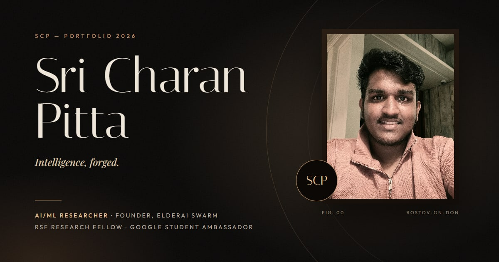
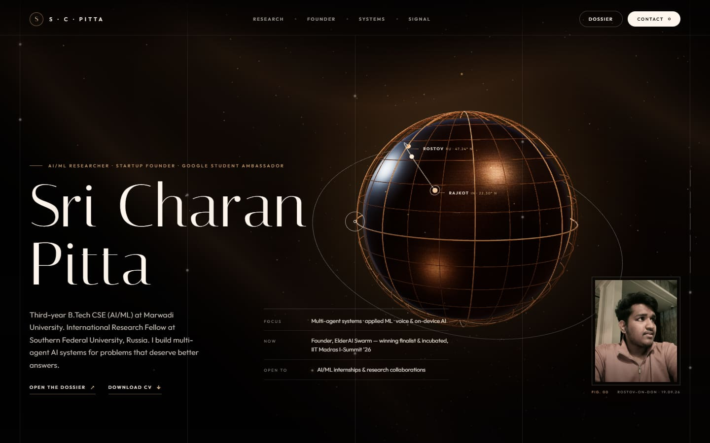
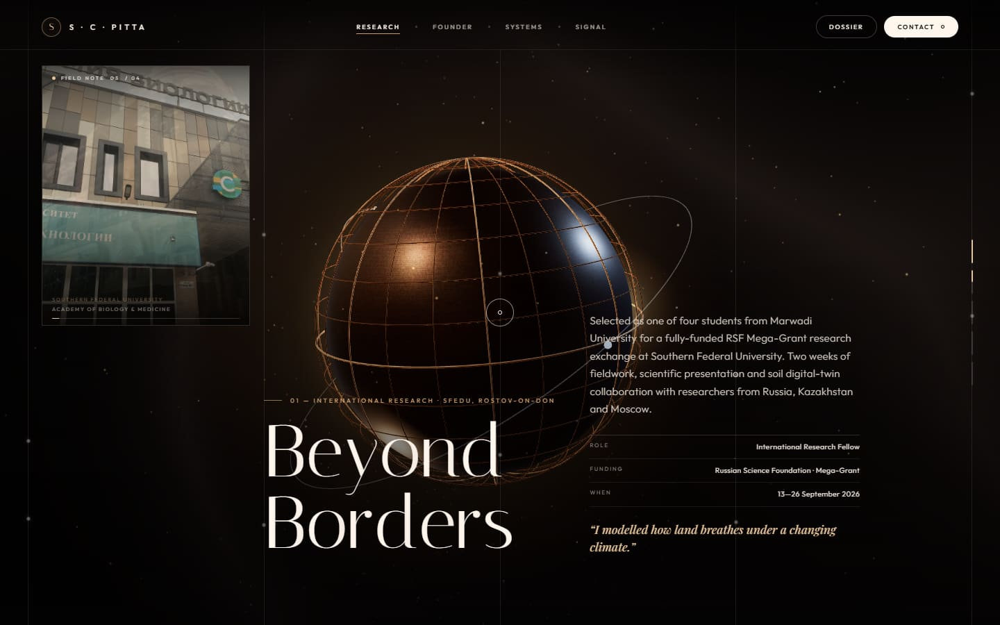
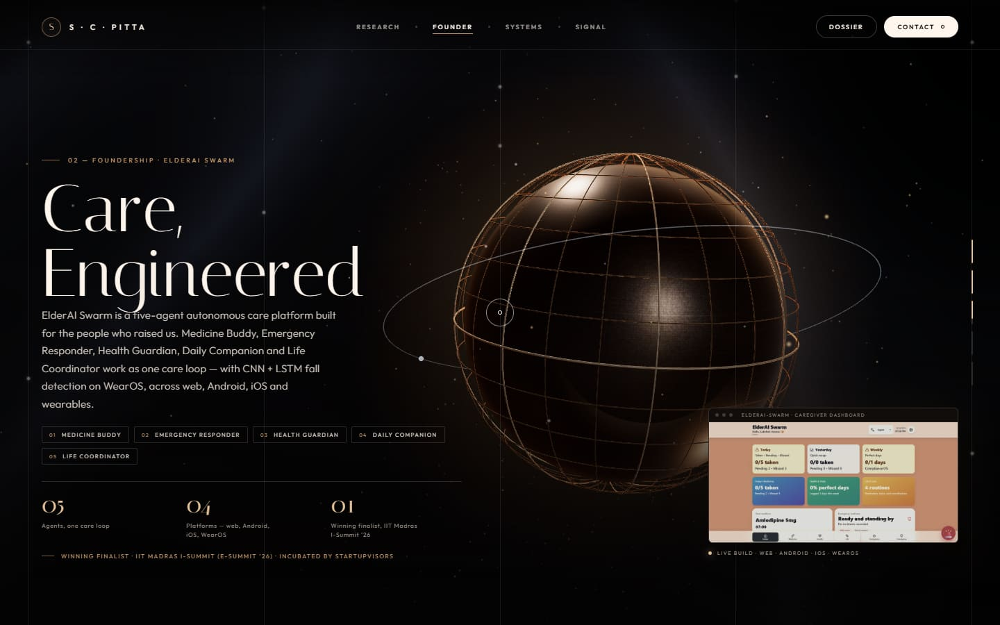
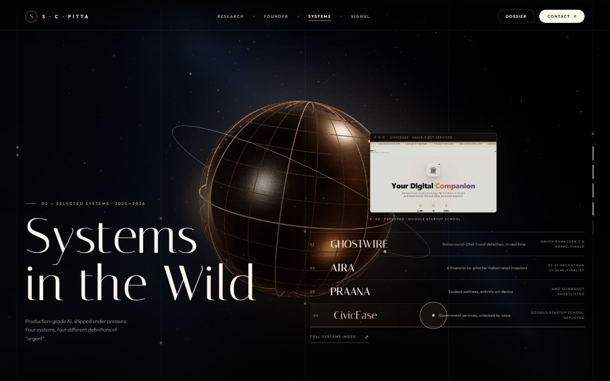
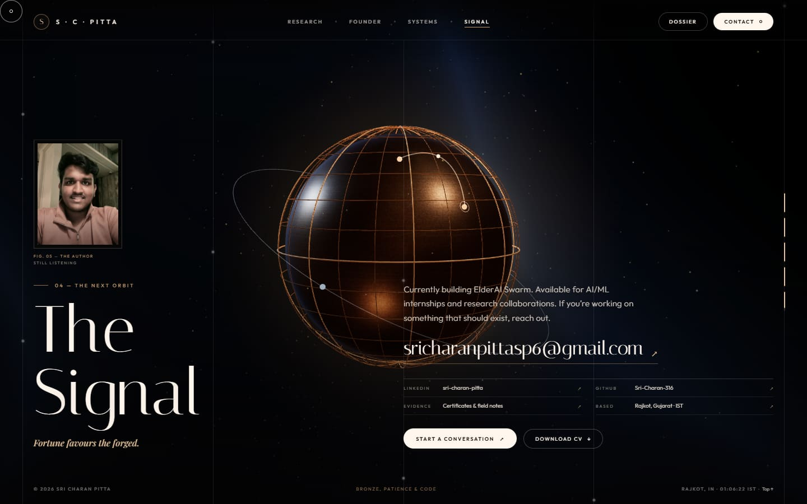
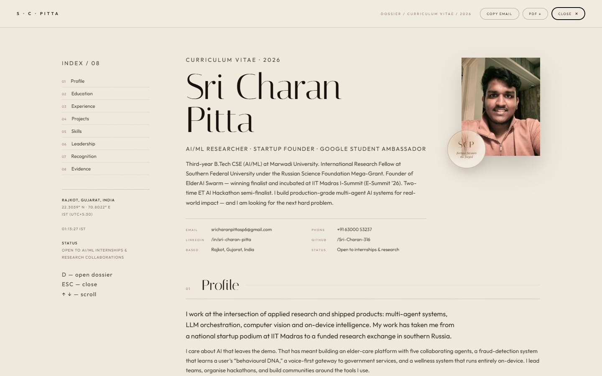
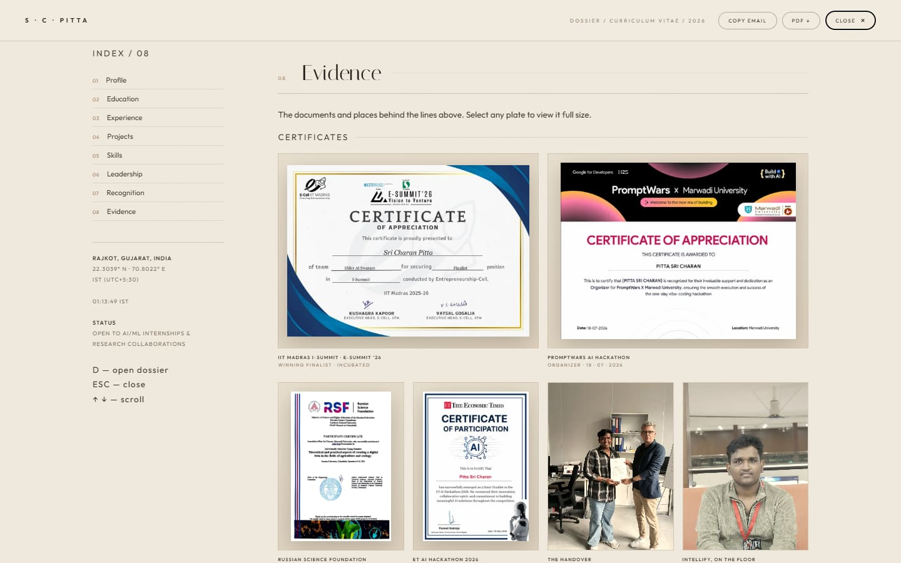
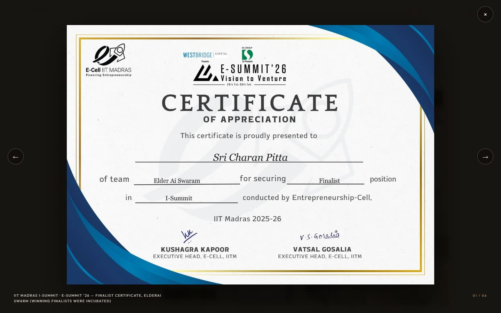
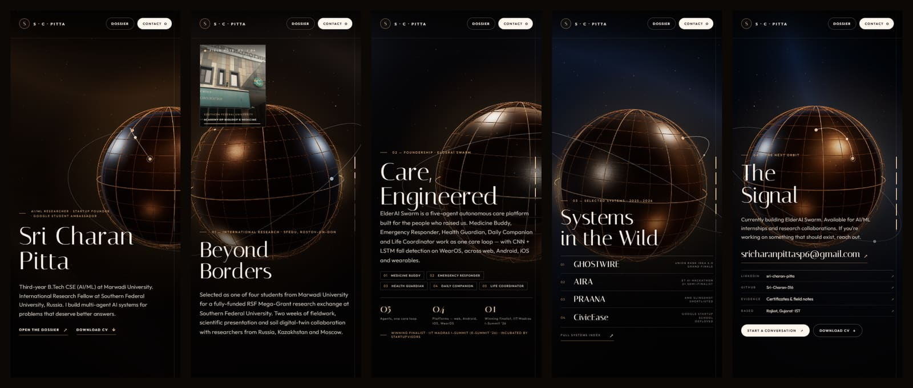

<div align="center">



# Sri Charan Pitta — *Intelligence, Forged.*

**AI/ML Researcher · Founder, ElderAI Swarm · RSF International Research Fellow · Google Student Ambassador**

[**Live site →**](https://sri-charan-3-1-6.github.io/Portfolio/) &nbsp;·&nbsp;
[Download CV](Sri_Charan_Pitta_CV.pdf) &nbsp;·&nbsp;
[LinkedIn](https://linkedin.com/in/sri-charan-pitta) &nbsp;·&nbsp;
[Email](mailto:sricharanpittasp6@gmail.com)

</div>

---

A cinematic, single-page portfolio in bronze and time. A real-time WebGL globe drifts behind five scroll-driven chapters, from Rajkot to Rostov-on-Don and back. Underneath it sits a full, printable dossier with every claim backed by evidence.

## The chapters

| | |
|---|---|
|  |  |
| **00 — Sri Charan Pitta.** A portrait, a flight path from Rajkot to Rostov, and the short version. | **01 — Beyond Borders.** RSF Mega-Grant research exchange at Southern Federal University, with a field-note photo reel. |
|  |  |
| **02 — Care, Engineered.** ElderAI Swarm: five agents, one care loop, and the live caregiver dashboard. | **03 — Systems in the Wild.** GHOSTWIRE, AIRA, PRAANA and CivicEase, with hover previews. |
|  |  |
| **04 — The Signal.** Contact and links, plus a way into the evidence. | **The Dossier.** Press <kbd>D</kbd> for the full CV: experience, projects, skills, leadership and recognition. |

### Evidence, not adjectives

| | |
|---|---|
|  |  |
| Certificates from IIT Madras E-Summit ’26, PromptWars, the Russian Science Foundation and the ET AI Hackathon, plus field photographs. | Every plate opens full size in an accessible lightbox. |

### On a phone



## Features

- **WebGL stage.** A Three.js bronze globe with a city flight arc, orbiting particles and scroll-choreographed camera moves. A static fallback is shown when WebGL or JavaScript isn't available.
- **Scroll storytelling.** Five fixed chapters with staggered reveals, a progress rail and keyboard navigation.
- **Dossier.** A full CV in an accessible modal with a focus trap, <kbd>Esc</kbd> to close and <kbd>D</kbd> to open. It prints to a clean A4 résumé with all media stripped.
- **Lightbox.** Grouped galleries with arrow-key navigation, a trapped focus loop and focus returned to the opener.
- **Media.** A muted stage video that plays only while it's on screen. It respects `prefers-reduced-motion` and has explicit play and sound controls.
- **Responsive.** Tuned layouts for desktop, laptop, short screens, phones and very small phones.
- **Performance.** Responsive WebP images in two sizes, lazy loading, and no build step and no framework. The site is one HTML file plus assets.
- **Share-ready.** Open Graph and Twitter cards, plus `Person` JSON-LD.

## Keyboard

| Key | Action |
|---|---|
| <kbd>D</kbd> | Open the dossier |
| <kbd>Esc</kbd> | Close the lightbox, then the dossier |
| <kbd>←</kbd> <kbd>→</kbd> | Previous / next image in the lightbox |
| <kbd>Tab</kbd> | Move through controls (focus stays inside open dialogs) |

## Structure

```
.
├── index.html                 # the entire site: markup, styles and scripts
├── Sri_Charan_Pitta_CV.pdf    # printable CV (generated from the dossier)
├── assets/                    # optimised WebP photos, certificates, screenshots, video, share card
└── docs/screens/              # README screenshots
```

## Run locally

No install and no build. Serve the folder over HTTP so the video and module imports load correctly:

```bash
npx serve .
# or
python -m http.server 8000
```

Then open the URL it prints.

## Deploy

The site is hosted on **GitHub Pages**: *Settings → Pages → Deploy from a branch → `main` / root*. `.nojekyll` is included so the files are served as-is.

## Built with

[Three.js](https://threejs.org/) · vanilla JavaScript · CSS · Google Fonts (Italiana, Outfit, Playfair Display)

---

<div align="center">
<sub>© 2026 Sri Charan Pitta. All rights reserved. The photographs, certificates and personal content are not licensed for reuse.</sub><br>
<sub><i>Fortune favours the forged.</i></sub>
</div>
